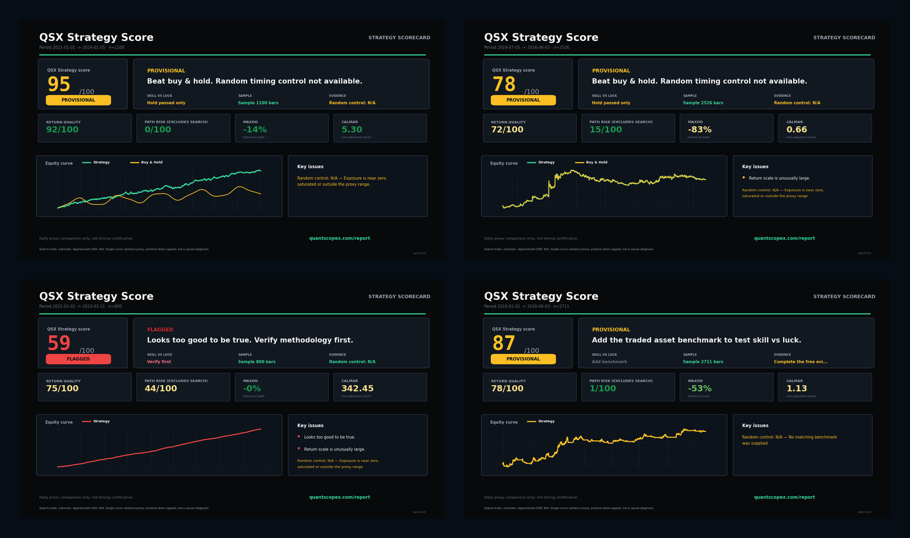

# QSX Strategy Score

[](https://github.com/jianweiweng05/qsx-strategy-score/actions/workflows/tests.yml)
[](LICENSE)
[](pyproject.toml)

Free open-source backtest screener for trading strategies.

Upload a return curve, equity curve, or trade log. In a few minutes, see whether the path looks more like alpha, market beta, luck, or a backtest that needs more evidence — without creating an account.

[**Try the free strategy scorecard**](https://www.quantscopex.com/score?utm_source=github&utm_medium=readme&utm_campaign=qsx_strategy_score&utm_content=hero_scorecard)

Other ways to use it: [install the free Chrome extension](https://chromewebstore.google.com/detail/qsx-strategy-score/ledfoflekcjogmfnmomcnlkinfpblgck) · [run it locally](#install-and-run) · [free TradingView indicator](https://www.tradingview.com/script/nY7jGyZu/) · [Overlay Preview](https://www.quantscopex.com/tools?utm_source=github&utm_medium=readme&utm_campaign=qsx_strategy_score&utm_content=overlay) · [full audit report](https://www.quantscopex.com/report?utm_source=github&utm_medium=readme&utm_campaign=qsx_strategy_score&utm_content=audit_report) · [security](SECURITY.md)

**中文 30 秒入口：** [免费网页评分与内置样例](https://www.quantscopex.com/zh/score?utm_source=github&utm_medium=readme&utm_campaign=qsx_strategy_score&utm_content=zh_quickstart)。账户收益/净值可做历史路径初筛；平仓交易日志只给描述统计，不计算账户分数或 Overlay。无需注册。也可按下方步骤本地安装，用 `--lang zh` 输出中文；CLI 支持六种语言。

Scoring thresholds and hosted components may still change before v1.0.

Upload actual account returns or equity to get a **QSX Score** from 0 to 100 and historical screening checks. Closed-trade logs provide descriptive trade statistics only; account performance, risk, ratings and Overlay are N/A.

- QSX Score and grade
- Overfit and too-good-to-be-true checks
- Buy-and-hold comparison
- Random timing test
- Monte Carlo stress test
- Shareable PNG scorecard
- Localized CLI, PNG scorecard, and web output (`en`, `zh`, `ja`, `ko`, `es`, `pt-BR`)
- Free Chrome extension
- Optional QSX Overlay Preview

Many strategies with a positive edge still fail because of poor risk sizing and exposure control. The optional Overlay Preview lets you test whether dynamic risk sizing may improve your own strategy.

## Free Chrome Extension

QSX Strategy Score is now available on the Chrome Web Store: [install the free Chrome extension](https://chromewebstore.google.com/detail/qsx-strategy-score/ledfoflekcjogmfnmomcnlkinfpblgck).

The extension is completely free. It lets you upload strategy exports, return curves, equity curves, or closed-trade logs directly from Chrome without setting up Python. Account paths receive screening checks; closed-trade logs receive descriptive statistics.

## Free TradingView Indicator

We also publish a free open-source TradingView script: [QSX Crypto Bottom & Top Risk Radar](https://www.tradingview.com/script/nY7jGyZu/).

It is a crypto market-context radar, not a trading bot or position-sizing engine. The script combines BTC perpetual long/short account ratio percentiles with trend, volatility, and trend-strength filters to mark sparse states such as `BOTTOM`, `CALM`, `TOP RISK`, and `HIGH RISK`.

If it helps your chart workflow, open it on TradingView, add it to a chart, and consider liking or favoriting it so more traders can find the free indicator.



## Positioning

QSX Strategy Score is not a replacement for QuantStats, pyfolio, or a full research notebook.

Use QuantStats when you want a detailed performance tear sheet. Use QSX Strategy Score when you want a fast screening answer:

```text
Is this backtest worth deeper due diligence, or does it look fragile, lucky, overfit, or mostly beta?
```

The output is intentionally compact: one path-quality score, evidence status, the main failure modes, a shareable scorecard, and an optional QSX Overlay Preview.

## How grades work

Version 0.4.0 narrows timing qualification to supported daily account-path comparisons. Unsupported inputs show a reason and N/A. The displayed path-risk index excludes search risk; omitted search-trial counts are unknown. See the [input and comparison contract](docs/input-comparison-contract.md).

The 0-100 number describes the uploaded path. It does **not** prove real alpha or production readiness.

- `PROVISIONAL` means the path may look promising, but benchmark, random-control, sample, or track-record evidence is still incomplete.
- `GOLD`, `SILVER`, and `BRONZE` require comparable benchmark evidence and passed available free checks.
- `NEEDS WORK` and `FLAGGED` indicate a material weakness or a backtest that should be verified before trusting its score.

Read the [calibration policy](docs/calibration.md) and [release governance](docs/release-governance.md) for the exact boundaries and version policy.

Scorecards link to a full audit-report workflow at `quantscopex.com/report` for users who want deeper due diligence after screening.

## Overlay Preview

QSX Strategy Score can preview an external risk-sizing layer:

**QSX Crypto Universal Position Engine 1.0**

It is not an entry signal, exit signal, or coin selector. It is designed as an overlay that sits outside your original strategy:

```text
original strategy returns x QSX dynamic exposure = overlay-adjusted curve
```

Inspect the [current published Controller evidence](https://www.quantscopex.com/tools?utm_source=github&utm_medium=readme&utm_campaign=qsx_strategy_score&utm_content=overlay_evidence) and its model version, data cutoff, costs and limitations. Historical results do not guarantee improvement on your strategy.

Overlay Preview does not accept trade logs. Upload actual account equity or daily returns; trade endpoints cannot identify the intervening account drawdown.

## Install and Run

The current core release is **v0.4.0**. Install from its GitHub tag; `qsx-score-free` is the distribution name, but it is **not currently published on PyPI**. GitHub release artifacts and PyPI publication are separate. Python 3.9–3.12 and Git are required for this source-install path.

```bash
git clone --branch v0.4.0 --depth 1 https://github.com/jianweiweng05/qsx-strategy-score.git
cd qsx-strategy-score
python3 -m venv .venv
source .venv/bin/activate
python -m pip install --upgrade pip
python -m pip install -e ".[app,excel]"
qsx-score --version
```

On Windows, activate with `.venv\Scripts\activate` instead. For CLI-only use, `python -m pip install -e .` installs the core dependencies without Streamlit or Excel support.

Run a bundled example without a market-data download:

```bash
qsx-score examples/sample_returns.csv --no-auto-asset --lang en
```

Missing benchmark evidence keeps the result provisional; it is not a failed installation. For a BTC comparison, download benchmark data first (requires access to the public data source), then score:

```bash
python -m qsx_strategy_score.assets --keys BTC
qsx-score examples/strategy_alpha.csv --asset BTC --lang en
```

Alternatively use `--benchmark your_prices.csv` with actual overlapping `date,close` prices. Local scoring itself does not upload strategy data. The optional data refresh and hosted Overlay Preview require network access.

Supported languages:

```bash
qsx-score examples/sample_returns.csv --no-auto-asset --lang zh
qsx-score examples/sample_returns.csv --no-auto-asset --lang ja
qsx-score examples/sample_returns.csv --no-auto-asset --lang ko
qsx-score examples/sample_returns.csv --no-auto-asset --lang es
qsx-score examples/sample_returns.csv --no-auto-asset --lang pt-BR
```

Export a shareable PNG, a three-page free diagnostic PDF, and JSON:

```bash
qsx-score examples/sample_returns.csv --no-auto-asset --out card.png --pdf diagnostic.pdf --json report.json
```

Run the web app:

```bash
streamlit run app/streamlit_app.py
```

## Read the result

Read the evidence status and reason beside the path score. `PROVISIONAL` or N/A asks for the missing evidence or explains an unsupported comparison; it is not an instruction to buy a report. A material failed check remains visible. A passing daily proxy cannot certify real alpha, and calibration remains `VALIDATED=False`.

## Input Formats

Returns:

```csv
date,return
2021-01-01,0.012
2021-01-02,-0.004
```

Equity curve:

```csv
date,equity
2021-01-01,10000
2021-01-02,10120
```

Trade log:

```csv
entry_time,exit_time,pnl_pct,side,symbol
2021-01-01,2021-02-01,3.2,LONG,DOGE
```

CSV, TSV and TXT are supported; Excel needs the `excel` extra. TradingView-style exports must satisfy the same input contract. Supported closed-trade logs require every entry/exit timestamp and one symbol, with no overlap; they return descriptive statistics only. Use real account returns or NAV for account performance and Overlay. See the [exact input and comparison contract](docs/input-comparison-contract.md).

## Docs

- [Scoring model](docs/scoring.md)
- [Reproducible v0.4.0 screening examples](docs/case-studies.md)
- [Calibration policy](docs/calibration.md)
- [Release governance](docs/release-governance.md)
- [QSX Overlay Preview](docs/overlay.md)
- [Privacy boundary](docs/privacy.md)
- [Security policy](SECURITY.md)
- [Methodology notes](docs/methodology.md)

## Choose the next step

| Your task | Free first step | Optional paid product |
| --- | --- | --- |
| Investigate your own backtest | [Strategy Score](https://www.quantscopex.com/score?utm_source=github&utm_medium=readme&utm_campaign=qsx_strategy_score&utm_content=screening) | [Pro Audit](https://www.quantscopex.com/report?utm_source=github&utm_medium=readme&utm_campaign=qsx_strategy_score&utm_content=audit_report), **$99 once** for deeper diagnosis of the submitted history and whether to enter the next validation stage |
| Manage existing crypto exposure | [Overlay compatibility Preview](https://www.quantscopex.com/tools?utm_source=github&utm_medium=readme&utm_campaign=qsx_strategy_score&utm_content=overlay#free-risk-check), using actual account returns/NAV | Risk Controller, **$79/month or $799/year**, for current model exposure, risk state and change alerts |
| Study a BTC/ETH model portfolio | [Public evidence and delivery sample](https://www.quantscopex.com/model-portfolios?utm_source=github&utm_medium=readme&utm_campaign=qsx_strategy_score&utm_content=portfolio#delivery-sample) | BTC/ETH research, **$149/month**, including Controller access |

Choose by need; these are not sequential upgrades. Preview is a free, optional compatibility check, not a subscription benefit. BTC/ETH final model weights already include their own controls: do not multiply them by the Controller again. Pro Audit uses sanitized performance history and stated assumptions, not your strategy source code; it does not approve live trading or provide a portfolio allocation.

## Important Limitations

Free = screening, not proof. QSX Strategy Score is computed from the uploaded performance path; it does not inspect strategy code, raw market data, execution simulation, exchange fills, or the full parameter-search process.

It cannot prove the absence of code-level look-ahead, survivorship bias, unrealistic fills or slippage, hidden leverage, capacity constraints, manual selection, or train/validation contamination.

A high score is not investment advice. A flagged score does not prove a strategy is fake; it means the backtest method should be checked before trusting the result.

## License

MIT.
